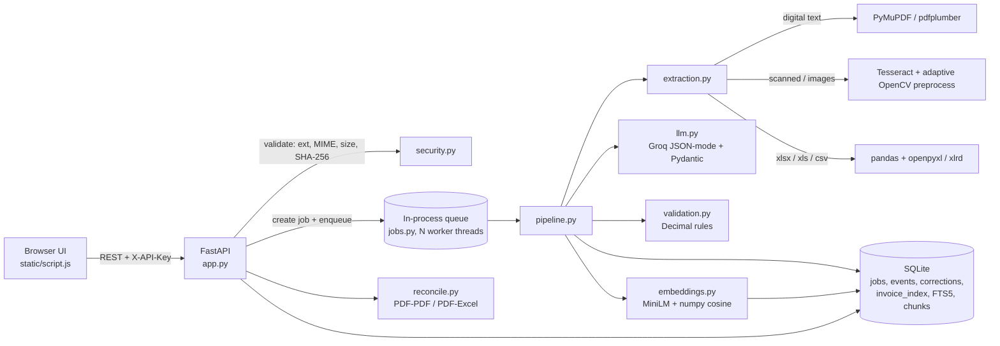

# Architecture

## Diagram

## Request flow

1. `POST /api/upload` checks extension, size (streamed read, capped), MIME (libmagic) and SHA-256.
   An identical file returns the existing job instead of being processed twice.
2. A `jobs` row (`queued`) and a `processing_events` row are written; the job id is put on the queue.
3. A worker thread runs `pipeline.process_document`:
   `extracting_text` -> `llm_extraction` -> `validating` -> `done` (each stage is written to `jobs.stage`
   and appended to `processing_events`, so the UI shows live progress and a history).
4. Results (`extraction`, `validation`) are stored as JSON; the FTS5 index, duplicate index and the
   semantic index are refreshed.
5. Corrections (`POST /api/jobs/{id}/correct`) re-run validation (including duplicate checks), update the
   indexes, and append to `corrections` + `processing_events`.
6. On startup, jobs left in `queued`/`processing` are re-queued, and persisted embeddings are loaded into memory.

## Modules

| File | Responsibility |
|---|---|
| `app.py` | REST API, auth, rate limiting, serves the UI |
| `auth.py` | API-key dependency (header or `?api_key=` for previews), constant-time compare |
| `config.py` | Environment-driven settings |
| `security.py` | Upload content validation (extension + MIME sniffing) |
| `jobs.py` | Queue + worker threads, stuck-job recovery |
| `pipeline.py` | Orchestrates one document end to end, records history |
| `extraction.py` | PDF text, per-page OCR routing, images/TIFF, spreadsheets |
| `preprocess.py` | OpenCV deskew/denoise/binarise (fallback only; see Design decisions) |
| `llm.py` | Prompt, Groq call with retries, schema check, chunk merge, cache |
| `validation.py` | Rule engine (Decimal arithmetic) |
| `reconcile.py` | Cross-verification between documents |
| `embeddings.py` | Chunking, embeddings, semantic search |
| `db.py` | SQLite access layer and schema |

## Design decisions

* **FastAPI + Python everywhere** - OCR, pandas and the LLM client are Python; a NestJS API would only add a
  second runtime and an integration layer.
* **SQLite (WAL) + FTS5** - zero-ops, one file, good enough for a single node. Swapping to PostgreSQL
  (+ pgvector) is isolated to `db.py`/`embeddings.py`.
* **In-process queue** - simple and has no extra service to run, but it is *not* horizontally scalable
  (see Known limitations in the README).
* **Adaptive OCR** - plain Tesseract first; OpenCV preprocessing only when the mean word confidence is low,
  keeping whichever variant scores higher. Measured on the evaluation set, always-on preprocessing turned
  `INV-2010` into `INV-2016` on a clean image.
* **Decimal for money** - float arithmetic is never used for validation.
* **LLM output is never trusted** - Pydantic schema, null for unknown values, per-field confidence, and
  deterministic validation afterwards.
* **Embeddings persisted** - stored in `chunks.embedding`, so a restart does not re-embed anything.
