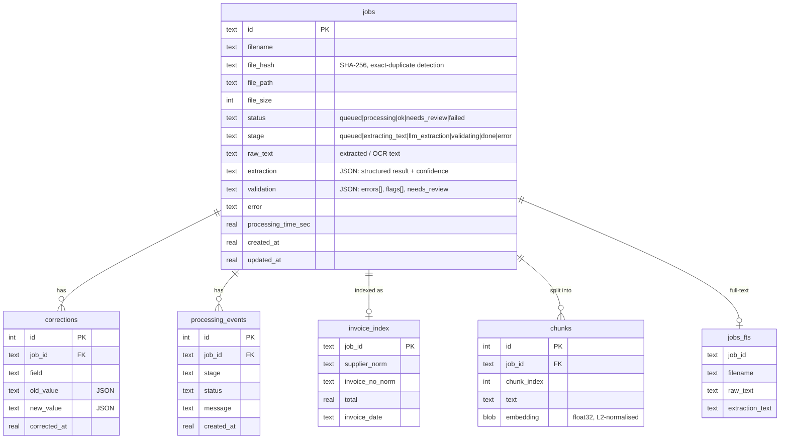

# Database schema

SQLite (WAL mode, foreign keys on), file at `DB_PATH` (default `data/app.db`).
The schema is created by `db.init_db()` and is safe to run repeatedly (existing databases are upgraded in place).

## Tables

| Table | Purpose | Notes |
|---|---|---|
| `jobs` | One row per uploaded document: metadata, extracted text, structured result, validation errors | indexes on `status`, `created_at`, `file_hash` |
| `processing_events` | Processing history: every stage transition, failure, reprocess, correction | index on `(job_id, id)` |
| `corrections` | Audit trail of manual edits (old/new value, timestamp) | cascade-deleted with the job |
| `invoice_index` | Normalised `(supplier, invoice_no)` for logical-duplicate detection | index on the pair |
| `jobs_fts` | FTS5 virtual table (filename, raw text, extracted values) for keyword search | rebuilt on completion and after each correction |
| `chunks` | ~800-char text chunks with stored embeddings for semantic search | loaded into memory at startup |

Line items live inside `jobs.extraction` (JSON). A relational `line_items` table was deliberately not added
yet: nothing queries line items individually.
